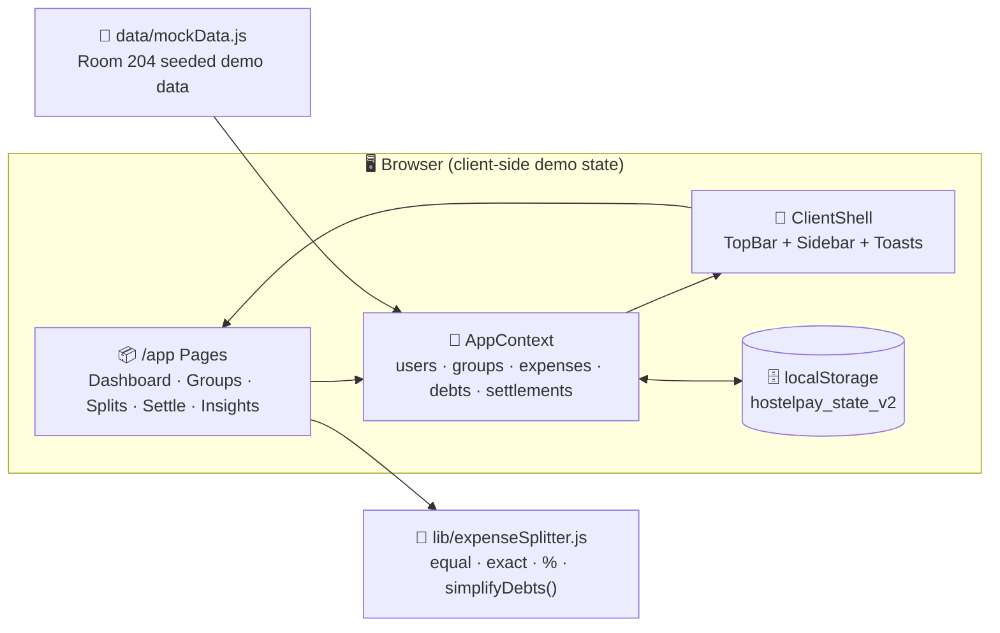

<div align="center">


<br>

[](https://nextjs.org)
[](https://react.dev)
[](https://tailwindcss.com)
[](#-license)
[](CONTRIBUTING.md)

<br>

**The roommate money app your hostel group chat actually needed.**
No more *"bhai tu kitna dene wala tha?"* confusion — add a shared expense, let the
math be penny-precise, and let the **AI debt simplifier** collapse a tangled web
of *"you owe me"* into **3 clean payments** instead of 5 messy ones.

🧪 **100% demo-safe** — everything runs in your browser with realistic hostel
data, simulated UPI settlements, and **no real money of any kind**.

</div>

---

## 🚀 Quick Start

```bash
# 1. Clone it
git clone https://github.com/sujitkr268/Hostel-Pay-AI.git
cd Hostel-Pay-AI

# 2. Install dependencies
npm install

# 3. Launch the dashboard
npm run dev          # → http://localhost:3000
```

> 💡 **Tip:** Use the app in the browser, sign in with any credentials on the demo login page,
> then explore → add a split → settle → hit **AI Insights**.

| Script | What it does |
| :--- | :--- |
| `npm run dev` | Starts the dev server on `localhost:3000` |
| `npm run build` | Production-optimized build |
| `npm run start` | Serves the production build |
| `npm run lint` | Runs ESLint checks |

---

## ✨ What's Inside

### 💸 Money & Splits
| Feature | Description |
| :--- | :--- |
| 🍰 **3 Split Modes** | **Equal**, **Exact**, or **%** — with penny-level precision so no one ends up owing `₹0.0000001` |
| 🧾 **Penny Dropping Logic** | Handles remainders like `₹583 / 4` correctly and fairly |
| 📱 **UPI QR Payments** | Generate & scan Hostel UPI QR codes, copy UPI IDs, simulated settle flow |
| 🔔 **Auto Reminders** | Payment request nudges sent on-screen (WhatsApp/SMS in future) |
| 🧮 **Live Balance Math** | Every added expense instantly recalculates *You owe* / *Owes you* per roommate |

### 🤖 AI-Powered Flow
| Feature | Description |
| :--- | :--- |
| 🧹 **Debt Simplifier** | Greedy min-cash-flow algorithm — turns N chaotic direct debts into the fewest fair transfers |
| 📊 **AI Spending Insights** | Monthly trends, category breakdowns & personalized saving recommendations |
| ✨ **AI Sparkle Mode** | Toggle AI assist behavior from Profile → Settings |
| 📄 **Downloadable Report** | One-click "download monthly report" (demo) |

### 🏠 Hostel Experience
| Feature | Description |
| :--- | :--- |
| 🏢 **Groups & Rooms** | Create *Room 204*, invite via code, manage hostel blocks |
| 🏠 **Group Cards** | Every group card shows lifetime spend, your share, and balance status |
| 👤 **Profile Suite** | UPI id, primary bank, biometric toggle, auto-approve under ₹500, notification channels |
| 💾 **Persistent State** | Everything saves to `localStorage` — refresh-proof, yet **Reset Demo Data** in one click |
| 🍿 **Toast Feedback** | Friendly animated toasts for every save, payment, or reminder |

---

## 🤖 The AI Debt Simplifier — Real Example

This is the engine behind *"clean up the who-owes-whom mess"* in
 [`lib/expenseSplitter.js`](lib/expenseSplitter.js).

<details>
<summary><b>🧮 See the worked example</b></summary>

Room 204 ends a month with **5 direct debts** floating around:

| Who owes whom | Amount |
| :--- | ---: |
| Saan → Sujit | ₹430 |
| Prakalpa → Sujit | ₹205 |
| Prakalpa → Saan | ₹180 |
| Garvit → Prakalpa | ₹390 |
| Garvit → Saan | ₹155 |

That's **₹1,360 of total confusion across 5 transfers** 💥

The simplifier computes net balances with the
**Greedy Min-Cash-Flow algorithm**, then issues:

| Clean payment | Amount |
| :--- | ---: |
| **Garvit → Sujit** | ₹545 |
| **Saan → Sujit** | ₹95 |
| **Garvit → Prakalpa** | ₹5 |

🎯 **₹1,360 across 5 messy transfers becomes just ₹645 across 3 transfers** —
same zero balances, way fewer pings and awkward asks.

</details>

---

## 🧠 How A Rupee Flows



---

## 🗂 Project Structure

```
Hostel-Pay-AI/
├── 📁 app/                      # Next.js App Router routes
│   ├── page.js                  # 🏠 Dashboard
│   ├── groups/                  # 👥 Group list + group detail timeline
│   ├── add-expense/             # ➕ Split editor (equal / exact / %)
│   ├── settle/                  # 💸 UPI-style settlement flow
│   ├── ai-insights/             # 🤖 Spending analytics + recommendations
│   ├── login/ · register/       # 🔐 Demo auth screens
│   └── profile/                 # 👤 Settings, UPI, rooms, demo reset
├── 📁 components/
│   ├── ClientShell.js           # Layout shell + toast root
│   ├── Sidebar.js · TopBar.js   # Navigation & search chrome
│   ├── Toast.js                 # 🍿 App-wide toasts
│   └── Modals/                  # 💸 Payment · QR · Create Group modals
├── 📁 context/
│   └── AppContext.js            # 🧠 Global state + localStorage persistence
├── 📁 data/
│   └── mockData.js              # 🧪 Seeded Room 204 (Tagore Hostel) data
├── 📁 lib/
│   └── expenseSplitter.js       # ✂️ Split math + 🤖 debt simplifier
└── 📁 assets/
    └── banner.svg               # 🎨 The hero banner you're reading
```

---

## 🧪 Try The Demo Flow

1. 🚪 Sign in / register (any email works — it's a demo)
2. 🏠 Land on the **Dashboard** → check *You owe* vs *You are owed*
3. ➕ Tap **Add Expense** → try exact split with a leftover penny
4. 💸 Go to **Settle Payments** → simulate a ₹500 UPI transfer to a roommate
5. 🤖 Open **AI Insights** → glance at trends + recommendations
6. 👤 From **Profile** → flip AI Sparkle, auto-approve, notification channels
7. 🔥 Done playing? **Reset Demo Data** — Room 204 is reborn

---

## 🗺 Roadmap

- [ ] 🔌 Real UPI deep-link payments (Razorpay / Cashfree)
- [ ] 🔥 Firebase / Supabase for true multi-user sync
- [ ] 🗣 Voice expense entry — *"Sujit spent ₹340 on chai"*
- [ ] 📱 PWA offline mode + installable app
- [ ] 📈 Monthly PDF export for AI Insights
- [ ] 🌙 Theme switcher (it's gorgeous dark now; respect the light lovers)

---

## 🤝 Contributing

PRs welcome! Fork → branch → commit → pull request.
Ideas? Open an issue and let's build the future of hostel finance together 💸

---

## 🔐 License

MIT © [Sujit Kumar](./LICENSE)

---

<div align="center">

**HostelPay AI** — *Split hostel expenses fairly. Settle in seconds.*

⭐️ Star this repo if it saved you from a *"tu ye nahi dete kya?"* argument.

</div>
