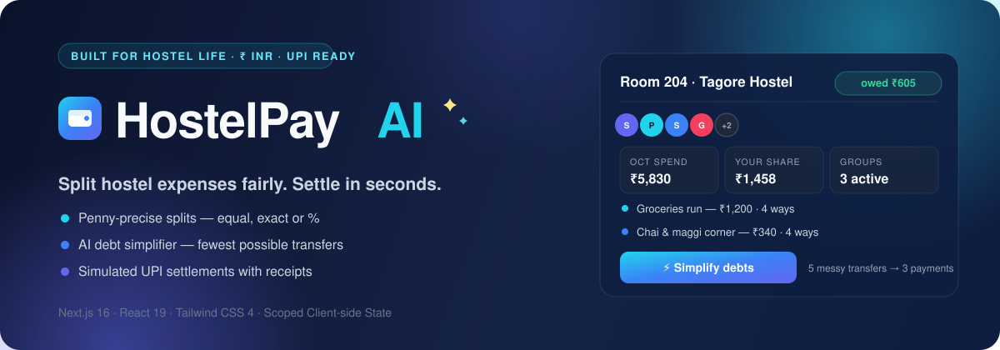

<div align="center">



<br>

[](https://nextjs.org)
[](https://react.dev)
[](https://tailwindcss.com)
[](#-license)
[](https://github.com/sujitkr268/Hostel-Pay-AI/pulls)

<br>

### 💸 Split hostel expenses fairly. Settle in seconds.

🧪 **100% demo-safe** — realistic hostel data, simulated UPI payments, **no real money**. It all runs in your browser.

</div>

---

## 🎬 See it work



<div align="center">

*One expense goes in… fair splits, clean debts and settled receipts come out. See the animated ₹ coin travel the pipeline.* 🪙

</div>

---

## ✨ What's inside



<details>
<summary><small>📖 prefer text? read the six cards here</small></summary>

- 🍰 **Smart Splits** — equal, exact or percent splits with penny-perfect remainders
- 🧹 **AI Debt Fix** — collapses the who-owes-whom web into the fewest fair transfers
- 💸 **UPI-style Settle** — scan the QR, copy the UPI ID, get a receipts ledger
- 📊 **AI Insights** — spend trends per category + personalized saving tips
- 🏠 **Groups & Rooms** — Room 204, invite codes, spend & your share at a glance
- 💾 **Saved in Browser** — refresh-proof localStorage state, one-tap Reset Demo Data

</details>

---

## 🤖 The magic trick 🔮

A month ends with *"Saan owes Sujit ₹430, Prakalpa owes Saan ₹180, Garvit owes someone something…"* 😵‍💫

**One tap** on the Settlement page → and `lib/expenseSplitter.js` runs a greedy **min-cash-flow** pass that turns the tangle into **just 3 direct payments**. Same balances. Zero circular drama. ✅

---

## 🚀 Run it locally

```bash
git clone https://github.com/sujitkr268/Hostel-Pay-AI.git
cd Hostel-Pay-AI
npm install
npm run dev        # → http://localhost:3000
```

<div align="center">

🔓 Sign in with **any credentials** — the login screen is part of the demo.

</div>

---

## 🧪 Fun things to try

1. ➕ Add a **₹583** expense → watch the leftover penny get dropped fairly
2. 💸 Simulate a **UPI settle** → balances and statuses flip instantly
3. 🤯 Tangle up some debts → hit the **AI fix** → watch 5 payments become 3
4. 🔥 Break Room 204? **Reset Demo Data** from Profile — good as new

---

## 🗺 What's next

- [ ] 🔌 Real UPI deep-links (Razorpay / Cashfree)
- [ ] 🔥 Firebase / Supabase multi-user sync
- [ ] 📱 PWA offline mode
- [ ] 📈 Monthly insights PDF export

---

## 🤝 Contributing

Fork → branch → PR. It's a small, friendly Next.js codebase to hack on. 🙌

<details>
<summary>📂 curious peek at the project layout</summary>

```
app/        → Next.js routes (dashboard, groups, add-expense, settle, ai-insights, profile, login)
components/ → UI shells, sidebar, toasts & modals (payment, QR, create group)
context/    → AppContext — global state + localStorage persistence
data/       → seeded demo data for Room 204, Tagore Hostel
lib/        → split math + AI debt simplifier
assets/     → this README's SVG art
```

</details>

## 🔐 License

MIT © Sujit Kumar

---

<div align="center">

**HostelPay AI** — *Split hostel expenses fairly. Settle in seconds.*

⭐️ Star this repo if it saved you from a *"tu ye nahi dete kya?"* argument

</div>
